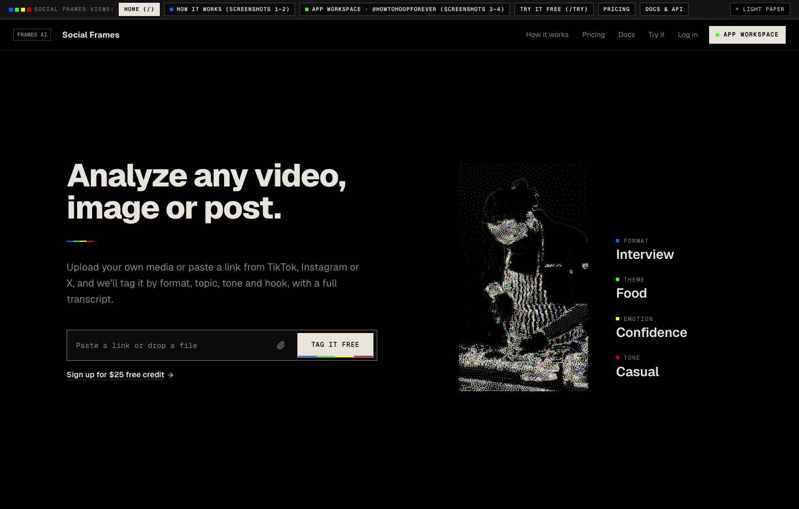
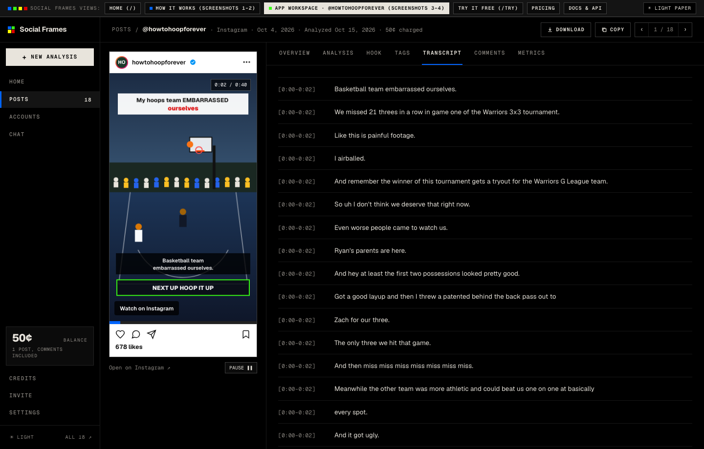
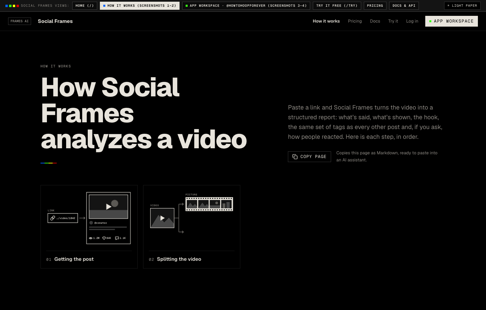
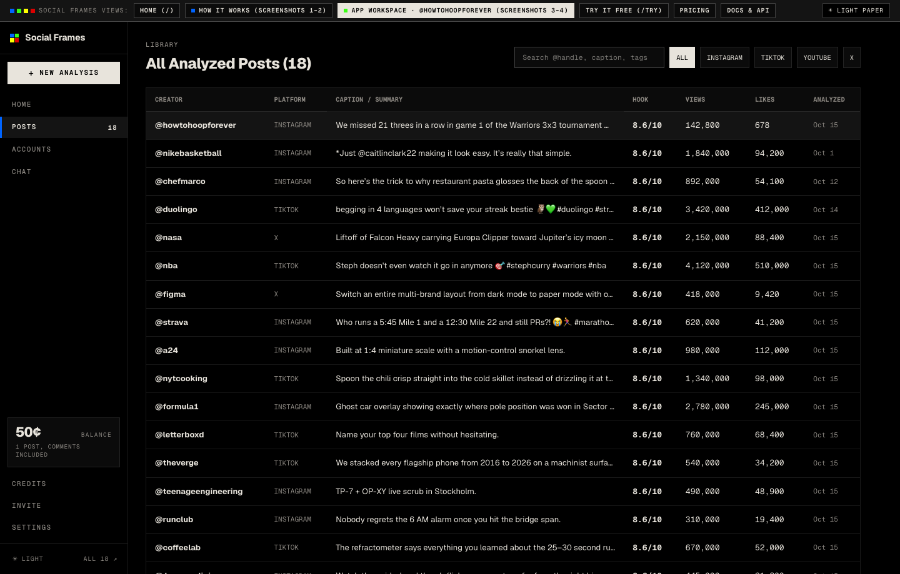
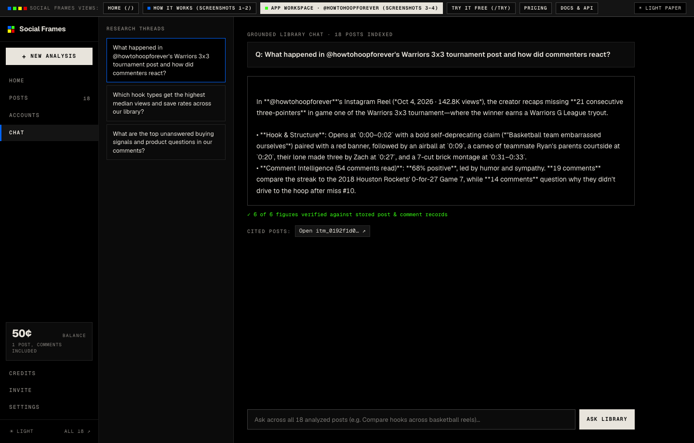
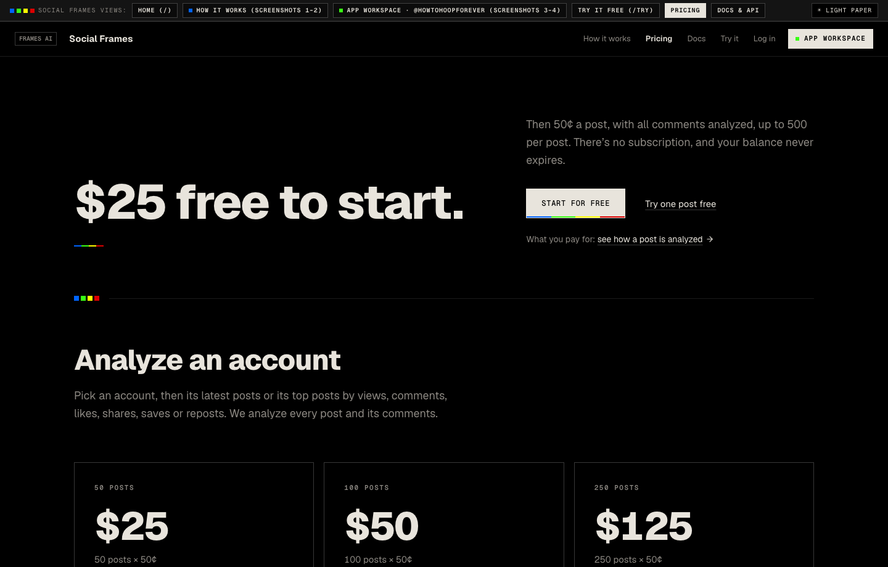

# Social Frames (`FRAMES AI`)

**Social Frames** is a full-featured web application for social video and post intelligence. It watches short-form and long-form social videos (**Instagram Reels**, **TikTok**, **YouTube Shorts**, **X**), splits scenes, transcribes audio with word-level timestamps, selects peak frames, scores the opening hook, tags visual and cultural signals, and synthesizes audience comments into structured **JSON**, **CSV**, and **Markdown** reports.

🔗 **Live App (GitHub Pages):** [`https://zainmasri.github.io/social-frames/`](https://zainmasri.github.io/social-frames/)  
📦 **Repository:** [`https://github.com/zainmasri/social-frames`](https://github.com/zainmasri/social-frames)

---

## 📸 Screenshots

### 1. Landing Page & Interactive Stipple Point-Cloud Hero (`#/`)


### 2. Authenticated `/app` Workspace — 7-Tab Post Intelligence Viewer (`#/app/post/...`)


### 3. How It Works — 8-Step Video & Comment Pipeline (`#/how-it-works`)


### 4. Analyzed Posts Library — Searchable & Filterable Across 18 Posts (`#/app/posts-list`)


### 5. Grounded Library Research Chat (`#/app/chat`)


### 6. Pay-As-You-Go Pricing & Volume Calculator (`#/pricing`)


---

## ✨ Key Features

- **8-Step Multimodal Video Pipeline**:
  1. **Getting the post** — Fetches media, caption, author metadata, and engagement metrics.
  2. **Splitting the video** — Detects hard cuts and scene boundaries, separating audio from image frames.
  3. **Transcribing speech** — Word- and segment-level speech recognition (`Qwen3-ASR-0.6B`).
  4. **Picking the frames** — Scores sharpness and visual novelty to select representative keyframes per beat.
  5. **Reading each scene** — Extracts on-screen text (OCR), visual action, and camera movement (`gpt-6.1-sol`).
  6. **Scoring the hook** — Evaluates the first 3 seconds (`0–10` hook score, hook style, promise vs. payoff).
  7. **Tagging the post** — Assigns a fixed schema of format, niche, topics, visual elements, emotions, and tone (`gpt-6-luna`).
  8. **Reading the comments** — Synthesizes up to 500 audience comments into sentiment breakdown, themes, questions, and buying signals.
- **7-Tab Post Workspace**: Switch seamlessly between `OVERVIEW`, `ANALYSIS` (beat-by-beat timeline), `HOOK`, `TAGS`, `TRANSCRIPT`, `COMMENTS`, and `METRICS`, with one-click `DOWNLOAD` (JSON / CSV / Markdown) and `COPY` actions.
- **Grounded Library Research Chat**: Ask cross-library questions across all 18 analyzed posts with verified figure checks and clickable post citations.
- **Interactive Narrated Launch Film**: Self-contained HTML/Canvas launch demo (`demo/social-frames-launch.html`) embedded directly on the home page.
- **Dual Editorial Themes**: Instant toggle between **Dark Carbon (`#000000`)** and **Light Paper (`#e8e4dc`)** with exposed `1px` hairline grids and 4-color RGBY signal accents.
- **Zero-Build Static HTML Architecture**: Runs directly from any static file server or **GitHub Pages** with zero external runtime dependencies.

---

## 📁 Directory & File Structure

All source code, embedded fonts, stylesheets, datasets, point-cloud animations, screenshots, and media assets live in the repository root:

```text
social-frames/
├── index.html                        # Main application entry point (loads CSS, templates, data & router)
├── app.js                            # Client router, authenticated /app workspace, 7-tab post viewer & canvas engine
├── pages-templates.js                # Public pages (Home, How It Works, Pricing, Docs, Try, Login, Signup) + Markdown exports
├── posts-data.js                     # 18 analyzed posts dataset (@howtohoopforever, @nikebasketball, etc.), accounts & chat threads
├── fonts.css                         # Embedded Geist & Geist Mono variable WOFF2 @font-face declarations
├── gar-core.css                      # Compiled Tailwind v4 utilities + Terminus design tokens (dark carbon & light paper)
├── styles.css                        # Design system tokens, hairline grids, buttons, sliders, and workspace layout rules
├── package.json                      # Convenience scripts for starting local servers (Python or Node.js)
├── .nojekyll                         # Ensures GitHub Pages serves all static files directly without Jekyll processing
├── .github/
│   └── workflows/
│       └── deploy-pages.yml          # Automated GitHub Actions workflow to publish the app to GitHub Pages
├── demo/
│   └── social-frames-launch.html     # Self-contained interactive narrated launch film (embedded on Home)
├── hero/
│   ├── chef.points.json              # Stipple point-cloud frame coordinates for Hero canvas
│   ├── kid.points.json               # Stipple point-cloud frame coordinates for Depth section
│   ├── launch.points.json            # Stipple point-cloud frame coordinates for Launch sequence
│   ├── chef.mp4                      # Source reference clip 1
│   ├── kid.mp4                       # Source reference clip 2
│   └── launch.mp4                    # Source reference clip 3
└── screenshots/                      # High-resolution application screenshots used in this README
    ├── 01-home.png
    ├── 02-workspace-post.png
    ├── 03-how-it-works.png
    ├── 04-posts-library.png
    ├── 05-research-chat.png
    └── 06-pricing.png
```

---

## 🚀 How to Run Locally

Social Frames uses a **zero-build static architecture**—all CSS (`gar-core.css`, `styles.css`), variable fonts (`fonts.css`), and JavaScript modules (`pages-templates.js`, `posts-data.js`, `app.js`) are pre-compiled and self-contained.

### Option A: Run with Python 3 (Recommended — Zero Install)

```bash
python3 -m http.server 8787 --bind 0.0.0.0
```

Then open **`http://localhost:8787`** in your browser.

### Option B: Run with Node.js / npm

```bash
npm run serve:node
# or:
npm start
```

Then open **`http://localhost:8787`** in your browser.

### Option C: Run with Docker / Nginx

```bash
docker run --rm -p 8787:80 -v "$(pwd):/usr/share/nginx/html:ro" nginx:alpine
```

---

## 🌐 Publishing as an HTML App on GitHub Pages

Because Social Frames uses hash-based routing (`#/`, `#/how-it-works`, `#/app/...`) and relative asset paths, it works out of the box on **GitHub Pages** without custom server rewrites.

This repository includes both `.nojekyll` and `.github/workflows/deploy-pages.yml`:

1. Push the repository to `main` on GitHub:
   ```bash
   git push -u origin main
   ```
2. Open **[`https://github.com/zainmasri/social-frames/settings/pages`](https://github.com/zainmasri/social-frames/settings/pages)** in your browser.
3. Under **Build and deployment → Source**, choose either:
   - **GitHub Actions** *(Recommended — automatically runs `.github/workflows/deploy-pages.yml` on every push to `main`)*, **or**
   - **Deploy from a branch** → select branch **`main`** and folder **`/ (root)`**, then click **Save**.
4. Within ~30–60 seconds, your live HTML app will be published at:
   **`https://zainmasri.github.io/social-frames/`**

---

## 🧭 Navigating the Application Routes

You can navigate via URL hashes or use the **top quick-switcher bar** to jump between views in one click:

| Route | View Description |
| :--- | :--- |
| `#/` | **Home Page**: Interactive point-cloud stipple hero, embedded launch film (`demo/social-frames-launch.html`), 5-layer analysis accordion, audience comment intelligence tabs, and pricing preview. |
| `#/how-it-works` | **How It Works (8-Step Pipeline)**: Overview 4×2 infographic grid, 8 animated SVG step diagrams (`01 Getting the post` through `08 Reading the comments`), model badges (`Qwen3-ASR-0.6B`, `gpt-6.1-sol`, `gpt-6-luna`), context-stacking matrix, fixed JSON schema, and **Copy page** (copies full page as Markdown). |
| `#/app/post/itm_0192f1d0c7a87b5e9a0c3f6e1d2b4a01` | **Authenticated `/app` Workspace — Post Detail (`@howtohoopforever`)**: Left sidebar + interactive Instagram Reel player + 7 segmented analysis tabs (`OVERVIEW`, `ANALYSIS`, `HOOK`, `TAGS`, `TRANSCRIPT`, `COMMENTS`, `METRICS`), `DOWNLOAD` menu, `COPY` menu, and `< 1 / 18 >` post pager. |
| `#/app/posts-list` | **All Posts Library**: Searchable and platform-filterable table of all 18 analyzed posts. |
| `#/app/new` | **New Analysis Job**: Submit any Instagram, TikTok, YouTube, or X URL to run the 8-step analysis pipeline. |
| `#/app/accounts` | **Tracked Accounts**: Account-level metrics and post discovery across creator handles. |
| `#/app/chat` | **Library Research Chat**: Grounded Q&A across all 18 analyzed posts with clickable post citations. |
| `#/app/credits` | **Credits & Ledger**: Balance overview (`50¢` default), instant credit top-up packs, and transaction history. |
| `#/pricing` | **Pricing & Calculator**: Interactive 4-slider monthly cost estimator (`50¢` per post, `1¢` metric refresh, `5¢` account pull, `5¢` chat question). |
| `#/docs` | **Documentation & API**: CLI, MCP, and REST API v1 reference with copyable snippets. |
| `#/try` | **Try It Free**: Interactive sandbox to test the 8-step analyzer on sample or custom URLs. |

---

## ⚙️ Configuration & Customization Guide

### 1. Configuring Initial App State (`app.js`)

Open `app.js` and edit the `state` object at the top of the file (lines 6–36) to customize default behavior:

```javascript
const state = {
  route: window.location.hash ? window.location.hash.slice(1) : "/",
  theme: localStorage.getItem("sf_theme") || "dark", // "dark" (#000000) or "light" (#e8e4dc warm paper)
  postId: "itm_0192f1d0c7a87b5e9a0c3f6e1d2b4a01",    // Default post opened in /app
  postTab: "transcript",                             // Default tab: "overview" | "analysis" | "hook" | "tags" | "transcript" | "comments" | "metrics"
  showOnScreenInBeats: true,                         // Show OCR/visual notes inside Beat-by-Beat timeline
  balanceCents: 50,                                  // Starting workspace credit balance in cents (50 = 50¢)
  ...
};
```

- **Default Landing Page**: To boot directly into the authenticated `/app` workspace instead of the marketing home page, change the `route` fallback from `"/"` to `"/app/post/itm_0192f1d0c7a87b5e9a0c3f6e1d2b4a01"`.
- **Default Theme**: Set `theme` default to `"light"` if you prefer the warm editorial paper theme (`#e8e4dc`) by default.

### 2. Customizing Theme Colors & Typography (`styles.css`)

Open `styles.css` (lines 4–78) to customize design tokens:

- **Dark Theme (`[data-theme="dark"]`)**:
  - `--bg: #000000` (Primary canvas background)
  - `--surface: #0b0b0b` / `--surface-2: #141414` (Elevated cards & sidebar active states)
  - `--ink: #e8e4dc` (Primary text color)
  - `--muted: #8b8781` (Secondary labels & timestamps)
  - `--line: rgba(255, 255, 255, 0.10)` (1px exposed hairline grid borders)
- **Light Theme (`[data-theme="light"]`)**:
  - `--bg: #e8e4dc` / `--surface: #f1eee8` / `--ink: #0a0a0a`
- **4-Color RGBY Brand Accents (`:root`)**:
  - `--cb: #0064ff` (Signal Blue — active tabs, links, primary indicators)
  - `--cg: #39ff14` (Signal Green — positive sentiment, high retention badges)
  - `--cy: #ffff00` (Signal Yellow — transcript & highlight markers)
  - `--cr: #dc0000` (Signal Red — negative sentiment, clank/alert indicators)

### 3. Adding or Modifying Analyzed Posts (`posts-data.js`)

All 18 analyzed posts, tracked accounts, and pre-baked research chat threads are defined in `posts-data.js`:

- **`window.SF_POSTS`**: Array of post objects following the fixed Social Frames schema (`item_id`, `source`, `caption`, `summary`, `brief`, `hook_analysis`, `temporal_analytics`, `fixed_tags`, `transcript`, `audience_reaction`, `comments_sample`, `metrics_history`).
- **`window.SF_ACCOUNTS`**: Array of tracked creator accounts shown in `#/app/accounts`.
- **`window.SF_CHAT_PREBAKED`**: Array of grounded Q&A threads shown in `#/app/chat`.
